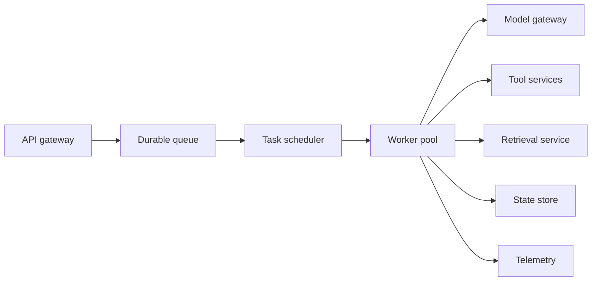

# Scaling AI Agents

## Objective

Scale agent systems while protecting latency, provider quotas, downstream platforms, and operational budgets. Most agent workloads are a mix of network-bound model calls, tool/API calls, retrieval, and CPU-bound preprocessing.

## Scalable architecture



## Scale by workload type

| Workload | Scaling signal |
|---|---|
| Interactive API | Concurrent requests, p95 latency |
| Background agent workers | Queue depth, oldest-message age |
| Log ingestion | Ingest rate and processing lag |
| Embedding jobs | Batch backlog and GPU/CPU utilization |
| Tool adapters | Downstream API latency and quota headroom |
| Retrieval | Query rate, latency, index load |

Do not use one autoscaling rule for every component.

## Queue-based execution

A durable queue decouples user traffic from worker capacity. Include request ID, tenant, task type, deadline, idempotency key, and trace context in each message. Use bounded message size and dead-letter queues for repeated failures.

Workers should:
- Claim work with visibility/lease timeouts.
- Check cancellation and deadline before each expensive step.
- Persist state after meaningful transitions.
- Use idempotency for tool operations.
- Acknowledge only after durable completion.
- Apply per-tenant concurrency limits.

## Concurrency and rate limits

Control concurrency at multiple levels:
- Global worker limit
- Per-tenant limit
- Per-model/provider limit
- Per-tool/API limit
- Per-cluster or cloud-account limit

Use token buckets or leaky buckets for request and token rates. Handle `429` responses using provider guidance and bounded exponential backoff with jitter. Avoid synchronized retries.

## Kubernetes deployment considerations

Deploy API, workers, and ingestion pipelines separately. Configure resource requests/limits, readiness/liveness probes, PodDisruptionBudgets, topology spread, and autoscaling. Use queue depth or custom metrics for worker scaling where appropriate.

Illustrative HPA for a worker Deployment based on CPU:

```yaml
apiVersion: autoscaling/v2
kind: HorizontalPodAutoscaler
metadata:
  name: agent-worker
  namespace: aiops
spec:
  scaleTargetRef:
    apiVersion: apps/v1
    kind: Deployment
    name: agent-worker
  minReplicas: 2
  maxReplicas: 12
  metrics:
    - type: Resource
      resource:
        name: cpu
        target:
          type: Utilization
          averageUtilization: 65
```

For queue-driven systems, consider an external/custom metric and validate the metrics adapter and scaling behavior. CPU alone may be a poor signal for I/O-bound agent workers.

## Backpressure

When providers or downstream tools slow down:
- Stop accepting optional low-priority work.
- Reduce worker concurrency.
- Queue within a defined maximum age.
- Reject or defer requests that cannot meet their deadline.
- Preserve capacity for critical incident workflows.
- Return clear degraded-mode responses.

## Reliability at scale

Use circuit breakers around providers and tools. Isolate failures by provider and tenant. Set timeouts on every network call. Use bulkheads so one slow integration cannot exhaust all workers. Make retries idempotent and distinguish transient from permanent failures.

## Capacity planning

Estimate concurrency using arrival rate and average service time. For rough steady-state planning, Little's Law is:

\[
L = \lambda W
\]

where \(L\) is average in-flight work, \(\lambda\) is arrival rate, and \(W\) is average time in the system. Add headroom for bursts, retries, provider throttling, and long-tail latency.

Load test with realistic prompt sizes, tool latency, failure rates, and provider quotas—not just synthetic HTTP requests.

## Metrics

Track queue depth, oldest task age, task throughput, worker utilization, in-flight tasks, model and tool latency, rate-limit responses, retries, deadline expirations, failure rate, and cost per completed task.

## References

- https://kubernetes.io/docs/tasks/run-application/horizontal-pod-autoscale/
- https://kubernetes.io/docs/concepts/workloads/controllers/deployment/
- https://opentelemetry.io/docs/
