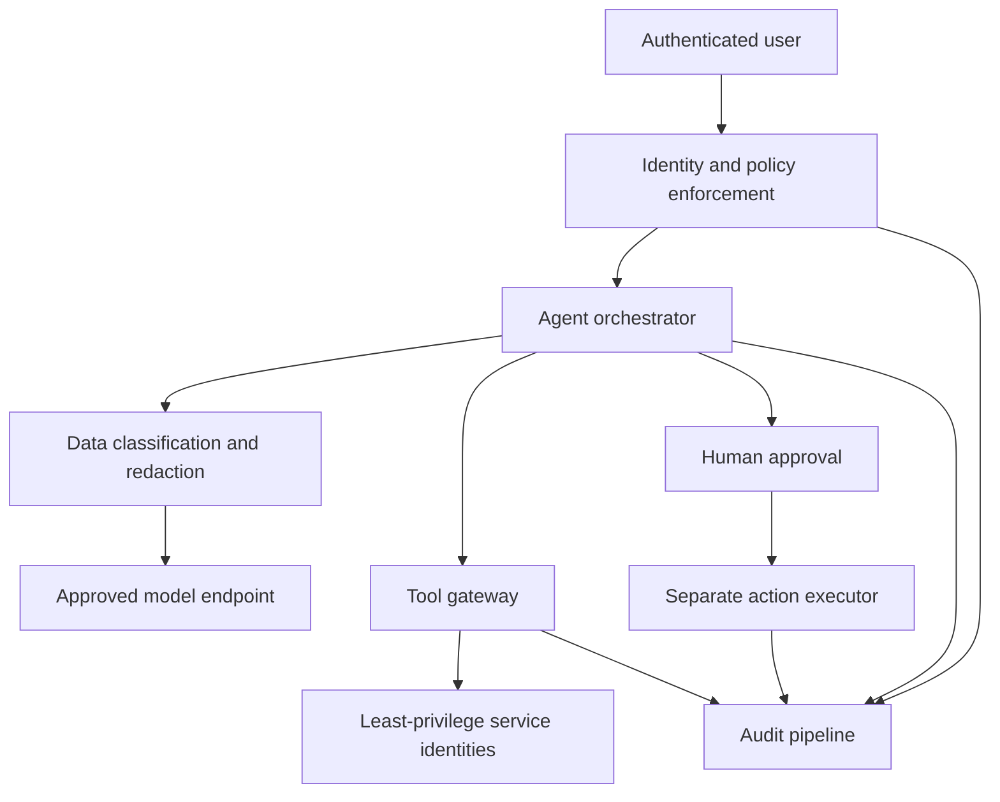

# Security and Governance for Production AI Agents

## Objective

Establish enforceable controls for identity, data protection, tool use, model behavior, human oversight, auditability, and lifecycle governance. Security must be implemented outside the prompt wherever possible.

## Threat model

Consider:
- Direct prompt injection from users
- Indirect prompt injection in logs, tickets, code, runbooks, and web pages
- Data exfiltration through model context or tool output
- Excessive agency and over-privileged tool credentials
- Cross-tenant retrieval or cache leakage
- Supply-chain compromise of models, libraries, tools, or MCP servers
- Insecure output handling and generated code execution
- Denial of service and uncontrolled inference spend
- Sensitive data retention or processing outside approved regions

## Security architecture

## Identity and authorization

- Authenticate users with enterprise identity and short-lived tokens.
- Authorize each task and every tool invocation.
- Enforce tenant, project, namespace, and environment scope.
- Use workload identity or short-lived credentials for service-to-service access.
- Keep read and write identities separate.
- Review permissions regularly and remove unused scopes.

The model must never decide whether the caller is authorized.

## Data protection

Classify data before retrieval and model submission. Minimize context, redact credentials and sensitive identifiers, encrypt data in transit and at rest, restrict retention, and document provider data-processing terms. Apply access-control filtering before vector retrieval results enter the prompt.

Do not assume that a document is safe to share because it is indexed in a vector database. Preserve source ACLs and enforce them at query time.

## Prompt injection and untrusted content

Treat user text, tool output, logs, tickets, repository files, annotations, and retrieved documents as untrusted data. Delimit evidence clearly, instruct the model not to follow embedded instructions, and—most importantly—ensure tool permissions and data access are independently enforced by code.

A prompt instruction is not a security boundary.

## Tool security

- Use typed, narrow tool schemas.
- Allowlist tool names, targets, namespaces, and operations.
- Validate arguments server-side.
- Deny arbitrary shell, filesystem, network, and cloud-console access by default.
- Apply egress controls and destination allowlists.
- Set tool timeouts, output limits, and rate limits.
- Require approval for destructive or externally visible actions.
- Record arguments, caller, policy decision, and result in an audit trail.

For MCP integrations, authenticate clients and servers appropriately, validate tool metadata and outputs, protect transport, and review server provenance and permissions.

## Human oversight

Define risk tiers. Low-risk read-only tasks may be automated. Medium-risk recommendations may require review. High-impact changes—such as production rollbacks, scaling beyond approved bounds, access-policy changes, or data deletion—must require explicit authorized approval and a controlled executor.

Approval records should include approver, action, target, evidence, policy version, timestamp, expiry, and outcome.

## Governance lifecycle

1. Register each agent, owner, purpose, and data classification.
2. Maintain an inventory of models, tools, datasets, prompts, and dependencies.
3. Assess risks before deployment and after significant changes.
4. Evaluate quality, bias, security, and failure modes.
5. Approve model/provider and data-processing configurations.
6. Monitor production behavior, cost, incidents, and drift.
7. Review access, retention, and vendor terms periodically.
8. Retire unused agents and revoke credentials.

## Audit events

Record:
- User and tenant identity
- Agent and workflow version
- Model/provider and version
- Prompt/template version identifier
- Tool calls and policy decisions
- Evidence references (not unnecessary raw sensitive payloads)
- Approval request and decision
- Action execution and verification
- Token usage, latency, and cost
- Errors, refusals, and escalation events

Protect audit records against tampering and restrict access.

## Governance checklist

- [ ] Named business and technical owner
- [ ] Documented purpose and prohibited uses
- [ ] Data classification and retention policy
- [ ] Model/provider approval and residency review
- [ ] Threat model and abuse-case testing
- [ ] Least-privilege tool permissions
- [ ] Prompt-injection and data-exfiltration tests
- [ ] Human approval for high-impact actions
- [ ] Evaluation dataset and release gates
- [ ] Monitoring, incident response, and audit trail
- [ ] Periodic access and vendor review
- [ ] Decommissioning and credential-revocation process

## Frameworks and references

- NIST AI Risk Management Framework: https://www.nist.gov/itl/ai-risk-management-framework
- OWASP Top 10 for LLM Applications: https://owasp.org/www-project-top-10-for-large-language-model-applications/
- ISO/IEC 42001 overview: https://www.iso.org/standard/81230.html
- Model Context Protocol security: https://modelcontextprotocol.io/specification/
- Kubernetes security: https://kubernetes.io/docs/concepts/security/
