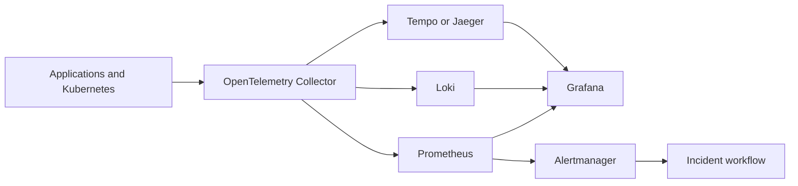

# AIOps Tools

## Overview
AIOps combines telemetry, analytics, event correlation, and automation to help operations teams detect anomalies, reduce alert noise, investigate incidents, and improve reliability.

## Tool categories

| Category | Examples | Primary use |
|---|---|---|
| Metrics and alerting | Prometheus, Alertmanager, VictoriaMetrics | Time-series metrics and alert routing |
| Dashboards | Grafana | Visualization and exploration |
| Logs | Loki, Elasticsearch, OpenSearch | Log search and aggregation |
| Tracing | Jaeger, Tempo, Zipkin | Distributed request tracing |
| Full-stack observability | Datadog, Dynatrace, New Relic, Splunk Observability | Unified telemetry and analytics |
| Incident management | PagerDuty, incident.io | On-call and escalation |
| Event correlation | ServiceNow ITOM, BigPanda, Moogsoft | Event grouping and service context |
| Cloud monitoring | AWS CloudWatch, Azure Monitor, Google Cloud Operations | Provider-native monitoring |
| Cost intelligence | AWS Cost Explorer, Azure Cost Management, Kubecost | Cloud and Kubernetes cost visibility |

Product features, pricing, and packaging change. Verify current vendor documentation before making a selection.

## Open-source cloud-native architecture

- Prometheus: metrics collection and PromQL.
- Alertmanager: grouping, routing, and silencing alerts.
- Grafana: dashboards and visualization.
- Loki: log aggregation and LogQL.
- Tempo or Jaeger: distributed tracing.
- OpenTelemetry: vendor-neutral instrumentation and collection.

## Commercial platforms

| Platform | Strengths to evaluate | Considerations |
|---|---|---|
| Datadog | Integrated infrastructure, APM, logs, security, cloud monitoring | Ingestion, retention, and host-based costs |
| Dynatrace | Full-stack observability, topology, automation, Davis AI capabilities | Licensing and implementation complexity |
| New Relic | APM, telemetry querying, dashboards, alerts | Data ingest and usage pricing |
| Splunk Observability Cloud | Metrics, tracing, infrastructure monitoring | Integration and total platform cost |
| ServiceNow ITOM | Event management and service context | Strongest fit where ServiceNow is central |

## Common AIOps use cases
1. Alert deduplication and event correlation.
2. Anomaly detection for latency, errors, saturation, and traffic.
3. Incident timeline generation.
4. Change-impact correlation after deployments.
5. Root-cause investigation support.
6. Capacity and resource forecasting.
7. Cloud and Kubernetes cost anomaly detection.
8. Runbook recommendation and controlled remediation.

## Selection criteria
- Supported data sources and integrations
- Metrics/logs/traces correlation
- Kubernetes and cloud coverage
- Alert quality and explainability
- Retention and query performance
- Data residency and access controls
- API and automation support
- Total cost at expected telemetry volume
- Exportability and vendor lock-in
- Operational skills required

## Hands-on evaluation
1. Instrument a sample service with OpenTelemetry.
2. Collect metrics, logs, and traces.
3. Create an alert for elevated error rate.
4. Generate a known incident and inspect the timeline.
5. Compare alert grouping and investigation workflows.
6. Measure detection time, false positives, investigation effort, and monthly cost.

## References
- https://opentelemetry.io/docs/
- https://prometheus.io/docs/
- https://grafana.com/docs/
- https://docs.datadoghq.com/
- https://docs.dynatrace.com/
