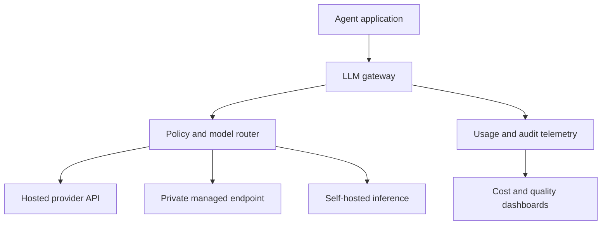

# LLM Platforms

## Overview
LLM platforms provide hosted or self-managed foundation models, inference endpoints, customization, safety controls, evaluation, and deployment infrastructure.

## Hosted model providers

| Platform | Model ecosystem / capabilities | Considerations |
|---|---|---|
| OpenAI API | GPT models, structured outputs, tool calling, embeddings | Model availability, pricing, data controls |
| Anthropic Claude | Claude models, tool use, long-context capabilities | Availability, API limits, data terms |
| Google Gemini / Vertex AI | Gemini models, multimodal features, Google Cloud integration | Distinguish developer API from enterprise Vertex AI |
| Amazon Bedrock | Multiple model providers, managed AWS integration, guardrails | Model and region availability |
| Azure AI Foundry | Model catalog, managed deployments, evaluation | Quotas and regional availability |
| Cohere | Language and retrieval models | Validate current model lineup and deployment choices |

## Open-weight and self-hosted ecosystem

| Tool / family | Purpose |
|---|---|
| Llama, Mistral, Qwen | Open-weight model ecosystems |
| Ollama | Convenient local model runtime for development |
| vLLM | High-throughput serving for supported models |
| Hugging Face Transformers | Model loading, inference, and fine-tuning |
| NVIDIA NIM | Packaged inference microservices |

Open-weight does not automatically mean unrestricted commercial use. Review the exact model license and acceptable-use terms.

## Platform architecture



## Selection criteria
1. Task quality on your own evaluation dataset.
2. Tool-calling and structured-output reliability.
3. Context window and multimodal requirements.
4. Latency and throughput under realistic concurrency.
5. Cost per successful task.
6. Data retention, training use, encryption, and residency terms.
7. Availability, quotas, and support commitments.
8. Fine-tuning, caching, batch inference, and evaluation features.
9. Model portability and fallback options.
10. Licensing and compliance.

## Provider abstraction example

```python
from typing import Protocol

class LLMClient(Protocol):
    def generate(self, *, system: str, user: str,
                 max_output_tokens: int) -> str:
        ...

def analyze_incident(client: LLMClient, evidence: str) -> str:
    return client.generate(
        system="Explain only what the supplied evidence supports.",
        user=evidence,
        max_output_tokens=1200,
    )
```

A production adapter should add async support, typed outputs, timeouts, cancellation, token accounting, error mapping, and tracing.

## Pricing and freshness
Model names, context limits, quotas, and prices change. Verify current official pricing:
- OpenAI: https://openai.com/api/pricing/
- Anthropic: https://www.anthropic.com/pricing
- Google: https://ai.google.dev/gemini-api/docs/pricing
- Amazon Bedrock: https://aws.amazon.com/bedrock/pricing/
- Azure: https://azure.microsoft.com/pricing/details/ai-foundry/

## Hands-on comparison
Use the same sanitized dataset and prompt for each candidate. Score factual correctness, evidence grounding, JSON validity, tool-call selection, refusal behavior, p95 latency, and cost. Record model version and evaluation date.

## References
- https://platform.openai.com/docs/
- https://docs.anthropic.com/
- https://ai.google.dev/gemini-api/docs
- https://docs.aws.amazon.com/bedrock/
- https://learn.microsoft.com/azure/ai-foundry/
- https://huggingface.co/docs
