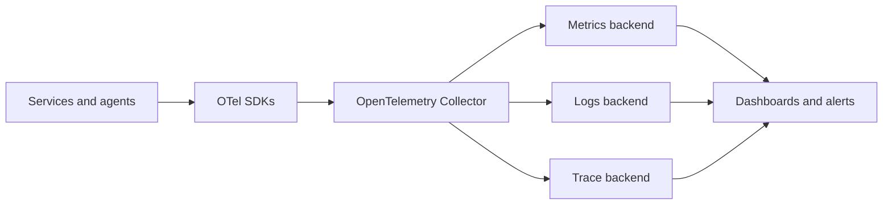

# Observability Tools

## Overview
Observability helps engineers understand system behavior from emitted telemetry. AI agents need visibility into both application operations and agent-specific activity: model calls, tool calls, retrieval, decisions, and cost.

## Three signals

| Signal | Question | Common tools |
|---|---|---|
| Metrics | How much, how often, how long? | Prometheus, VictoriaMetrics, Datadog |
| Logs | What happened? | Loki, Elasticsearch, OpenSearch, Splunk |
| Traces | Where did time go across services? | Jaeger, Tempo, Zipkin, vendor APM |

OpenTelemetry provides vendor-neutral APIs, SDKs, semantic conventions, and collectors.

## Tool landscape

| Area | Open-source options | Commercial / managed options |
|---|---|---|
| Metrics | Prometheus, VictoriaMetrics, Mimir | Datadog, New Relic, Dynatrace |
| Dashboards | Grafana | Grafana Cloud, Datadog |
| Logs | Loki, OpenSearch, Elasticsearch | Splunk, Datadog, New Relic |
| Tracing | Jaeger, Tempo, Zipkin | Honeycomb, Datadog, Dynatrace |
| Collection | OpenTelemetry Collector, Fluent Bit, Vector | Managed vendor collectors |
| AI/LLM observability | Langfuse, Arize Phoenix, OpenTelemetry-based tracing | Provider and specialist platforms |

## Reference architecture



## AI agent telemetry
Capture:
- Request and workflow ID
- Agent and workflow version
- Model/provider identifier
- Prompt template version (not necessarily prompt contents)
- Input/output token counts
- Model latency and error class
- Tool name, duration, status, and retry count
- Retrieval latency and document identifiers
- Validation failures and human approvals
- Estimated cost and task outcome

Never log API keys, access tokens, raw secrets, or unnecessary sensitive prompt content. Apply redaction and access controls.

## Prometheus examples

Request rate:

```promql
sum(rate(http_requests_total{service="agent-api"}[5m]))
```

Error ratio:

```promql
sum(rate(http_requests_total{service="agent-api",status=~"5.."}[5m]))
/
clamp_min(sum(rate(http_requests_total{service="agent-api"}[5m])), 1)
```

p95 latency:

```promql
histogram_quantile(
  0.95,
  sum by (le) (rate(http_request_duration_seconds_bucket{service="agent-api"}[5m]))
)
```

Metric names depend on instrumentation. Avoid high-cardinality labels such as raw prompts, request IDs, or arbitrary user-provided values.

## Grafana dashboard panels
1. Request rate and active workflows
2. Success, failure, and timeout rate
3. End-to-end latency p50/p95/p99
4. Model latency and provider error rate
5. Tool calls per task and tool failure rate
6. Queue depth and oldest task age
7. Token usage and estimated cost
8. Evaluation quality and groundedness
9. Approval rate and remediation outcomes

## Alerting
Alert on sustained SLO burn, queue age exceeding task deadlines, provider error spikes, abnormal token cost, and tool failure rates. Route operational incidents to on-call and model-quality regressions to the AI platform owner.

## References
- https://opentelemetry.io/docs/
- https://prometheus.io/docs/
- https://grafana.com/docs/
- https://grafana.com/docs/loki/latest/
- https://grafana.com/docs/tempo/latest/
- https://www.jaegertracing.io/docs/
